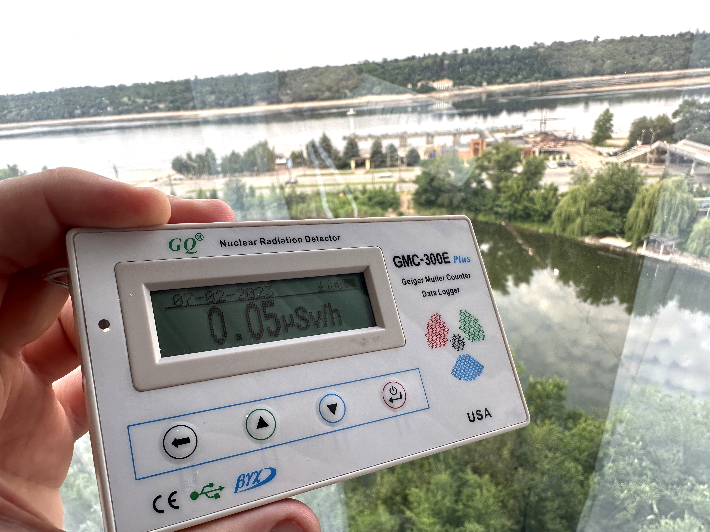

# GMC-300E / GMC-300Re Geiger counter controller



*GQ GMC-300E in the field. Photo by Enno Lenze, CC BY 2.0 — see [CREDITS.md](CREDITS.md).*

This directory contains `gmc300e.sh`, a pure-bash controller for the GQ
GMC-300E / GMC-300Re Geiger-Müller counter connected over USB. It also documents
the OpenCode `gmc-300e` skill that bundles the same controller.

The counter used here identifies as **GMC-300Re 4.70** (serial
`f7f4c55904d10c`). Its normal background is roughly **10–25 CPM**, and battery
voltage is around **4.1 V** when charged.

## The device

- **USB bridge:** QinHeng CH340, `1a86:7523`, driver `ch341`
- **Stable port:** `/dev/serial/by-id/usb-1a86_USB_Serial-if00-port0`
  (usually `/dev/ttyUSB0`)
- **Serial settings:** **57600 8N1**
- **Permissions:** the node is owned by `root:uucp`. The controller re-execs
  itself with `newgrp uucp` when the session lacks write access.
- **Power:** after `off`, the counter stops answering until `on` or a physical
  key press.
- **Buttons:** `key 0`–`key 3` map to S1–S4. S2/S3 can enter an on-screen menu
  where serial commands are ignored; press `key 0` to go back.

A freshly woken tube can read 0 CPM briefly. A couple of minutes of recovery
may be needed after a high dose. Do not declare hardware failure from one zero
reading.

## The script

`gmc300e.sh` needs only bash plus coreutils (`stty`, `od`, `timeout`) — no
pyserial, no sudo helper.

```sh
./gmc300e.sh --help
./gmc300e.sh status
./gmc300e.sh cpm
./gmc300e.sh displayunit
./gmc300e.sh displayvalue
./gmc300e.sh live
./gmc300e.sh --csv live 3600 > hour.csv
./gmc300e.sh synctime
```

Highlights:

- **Read commands:** `version`, `status`, `cpm`, `cps`, `volt`, `datetime`,
  `config`, `displayunit`, `displayvalue`, `history`, `live`.
- **Configuration:** `displayunit` reads the LCD unit; `-v config` decodes known
  fields; `displayvalue` converts the instrument's current CPM to that unit.
- **Clock:** `synctime` is preferred. It writes host local time as raw bytes,
  reads it back, and warns if the clocks differ by more than 3 s.
- **Destructive commands:** `wcfg`, `ecfg` and `factoryreset` require explicit
  intent **and** `--yes` before the command, for example
  `./gmc300e.sh --yes wcfg 3 2`.
- **Raw access:** `raw '<GETCPM>>'` sends an arbitrary protocol command.

### Live monitoring

`live` reads the display unit from config byte 3 before streaming and converts
the instrument's own CPM every second, so the displayed unit matches the LCD.
Because the LCD uses a rolling CPM (not the heartbeat-derived running average),
`live` shows both:

```text
timestamp  CPS  total  hb CPM  dev CPM    mR/h   mR/h+  LEVEL
11:48:47     0      0      0       27        0.02       0.018  NORMAL[<1µSv/h]
```

- `mR/h` is the LCD-style 2-decimal value.
- `mR/h+` is a 3-decimal value so low-background movement is visible.
- CSV adds `device_cpm`, `display_unit`, `display_value`, `display_precise`,
  `level` and `level_label`.

Rows are colour-coded when stdout is a terminal:

| Colour | `LEVEL` text | Meaning |
| --- | --- | --- |
| green | `NORMAL[<1µSv/h]` | normal / low |
| yellow | `CAUTION[>=1µSv/h]` | do not linger |
| red | `EVACUATE[>=10µSv/h]` | leave now |

Use `--color` / `--no-color` or `NO_COLOR` to control colour. `--csv` is never
coloured. Change the cut-offs with `GMC_SAFE_MAX_USV` and `GMC_DANGER_MIN_USV`;
the bracketed values update automatically. These are conservative logging aids,
not radiation-safety advice.

`live` enables the hardware heartbeat and sends `<HEARTBEAT0>>` on normal exit
and on Ctrl-C. If the process is killed with SIGKILL, clear it with:

```sh
./gmc300e.sh raw '<HEARTBEAT0>>'
```

## The OpenCode skill

The installable skill lives in [`skill/`](skill/) in this repository:

```text
skill/
├── SKILL.md
├── scripts/gmc300e.sh
└── references/
    ├── protocol.md
    └── troubleshooting.md
```

Install or update it in OpenCode with:

```sh
cp -r skill ~/.config/opencode/skills/gmc-300e
```

`SKILL.md` describes safe workflows and ground rules.
`references/troubleshooting.md` covers connection, permission, zero-CPM, clock
and heartbeat problems. `references/protocol.md` is the command/byte reference
learned from the real device, including corrections to the manufacturer spec.
The paths in these files reflect the author's Linux machine; adjust the port
and user name if yours differ.

The controller bundled with the skill must stay byte-for-byte identical to the
main script. Both the repository copy and any installed copy are kept in sync
by:

```sh
./scripts/sync-skill.sh          # copy and verify
./scripts/sync-skill.sh --check  # verify only
```

## Documentation and assets

Offline reference material is included so the project is usable without a
network connection:

```text
docs/
├── README.md                              # index of offline docs
├── manual/
│   ├── GMC-300E-Plus-User-Guide.pdf       # manufacturer guide, Rev 2.13
│   └── GMC-Quick-Start-Guide.pdf          # GQ GMC series quick start
└── protocol/GQ-RFC1201.txt                # official serial protocol spec
assets/
├── gmc-300e-in-use.jpg                    # GMC-300E photo (CC BY 2.0)
└── gmc-300s-white.png                     # sibling GMC-300S product photo (CC BY-SA 4.0)
```

See [`docs/README.md`](docs/README.md) for what each file is and how to refresh
it. [`CREDITS.md`](CREDITS.md) records upstream URLs, authors and licences:

```sh
./scripts/fetch-assets.sh          # re-download and verify checksums
./scripts/fetch-assets.sh --check  # verify local files only
```

The downloaded manual, quick-start guide and protocol text are third-party
GQ Electronics documents, and the photos are Creative Commons licensed; none of
them are covered by this repository's MIT licence. Keep the credits if you
redistribute them.

## Repository layout

```text
.
├── gmc300e.sh            # canonical controller script
├── README.md             # this file
├── LICENSE               # MIT licence for the original code/docs
├── CREDITS.md            # third-party sources and licences
├── docs/                 # offline manuals and protocol
├── assets/               # device photographs
├── skill/                # installable OpenCode skill
└── scripts/              # asset download and skill sync helpers
```

## Protocol notes

The protocol is host-initiated: commands start with `<` and end with `>>`, e.g.
`<GETCPM>>`. Replies are binary, not ASCII hex. Multi-byte integers are
big-endian unless noted.

| Command / field | Detail |
| --- | --- |
| `GETVER` | 14 ASCII bytes, e.g. `GMC-300Re 4.70` |
| `GETCPM` | 2 bytes, big-endian CPM |
| `GETCPS` | 2 bytes; top bit is a marker, mask with `0x3fff` |
| `GETVOLT` | 1 byte; value × 0.1 V |
| `GETDATETIME` | 7 bytes; first six are YY MM DD hh mm ss |
| `GETCFG` | 256 bytes |
| `GETSERIAL` | 7 bytes |

`GETCFG` fields used here:

| Offset | Meaning |
| --- | --- |
| 0 | Power state: `0x00` = ON, `0xFF` = OFF on this 300-series unit |
| 1 | Alarm enabled |
| 2 | Speaker enabled |
| 3 | LCD radiation unit: `0` = CPM, `1` = µSv/h, `2` = mR/h |
| 8, 14, 20 | Calibration points: CPM uint16 BE + µSv/h float32 **little-endian** |
| 32 | History save type |
| 49–50 | Max CPM |
| 56 | Battery type |
| 57 | Baud-rate code (`252` = 57600) |

Conversion uses piecewise-linear interpolation through the three calibration
points with a leading `(0,0)` point. On this unit they are effectively linear:
60 CPM = 0.39 µSv/h, 240 = 1.56, 1000 = 6.5, or about **153.8 CPM per µSv/h**.
mR/h is µSv/h ÷ 10, matching the instrument's 328 µSv/h = 32.8 mR/h ranges.

Heartbeat packets are 2-byte CPS values with bit 15 set; the script masks with
`0x3fff` and preserves heartbeat bytes consumed while polling `GETCPM`.

### The raw-byte trap

`SETDATETIME`, `SETDATE*`, `SETTIME*`, `WCFG` and `SPIR` parameters must be sent
as **genuine binary bytes**, not ASCII hex text. Sending hex text corrupts the
clock. `tx_bytes()` in the controller does this correctly. Also note that flash
cannot flip a bit from `0` to `1` with a single `WCFG`; a full-config rewrite via
`ECFG` + `WCFG` + `CFGUPDATE` may be needed. Back up the config first.

Commands noted as unsupported or unhelpful on this model: `GETTEMP` returns
`00 00 00 aa`, and `GETGYRO` returns meaningless bytes. Wi-Fi/server commands
from RFC1801 are for GMC-500/600+ models.

The official protocol document is included at
[`docs/protocol/GQ-RFC1201.txt`](docs/protocol/GQ-RFC1201.txt), but treat the
observations in [`skill/references/protocol.md`](skill/references/protocol.md)
as authoritative for this specific firmware — notably the 115200 baud figure
in the spec does not apply to this unit, which uses 57600.

## Licence

The original code and documentation here are MIT licensed; see [`LICENSE`](LICENSE).
Third-party manuals and photographs under `docs/` and `assets/` keep their own
licences as detailed in [`CREDITS.md`](CREDITS.md).

This project is an independent, unofficial controller. GQ Electronics is not
affiliated with it. The level labels are conservative logging aids, not
radiation-safety advice.
